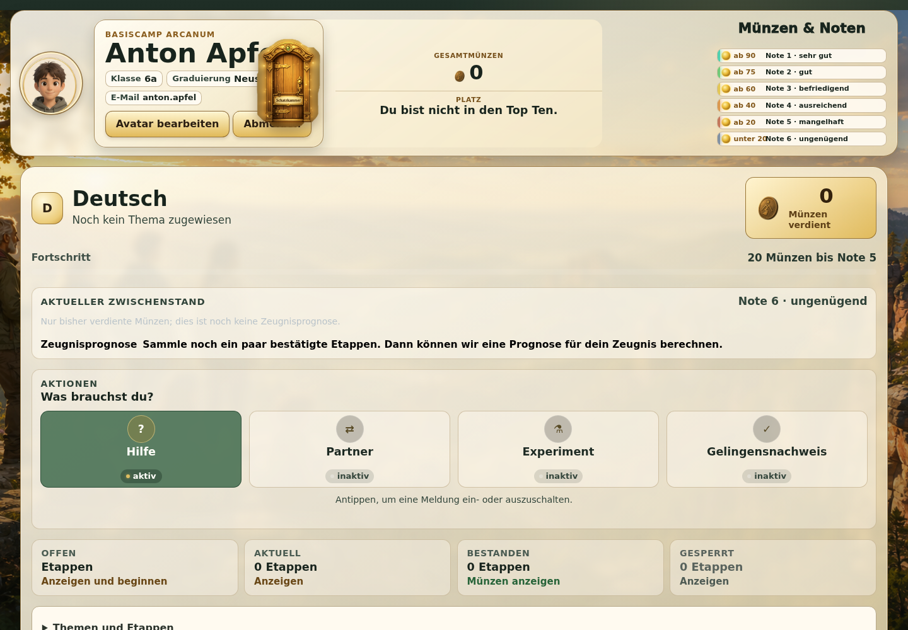
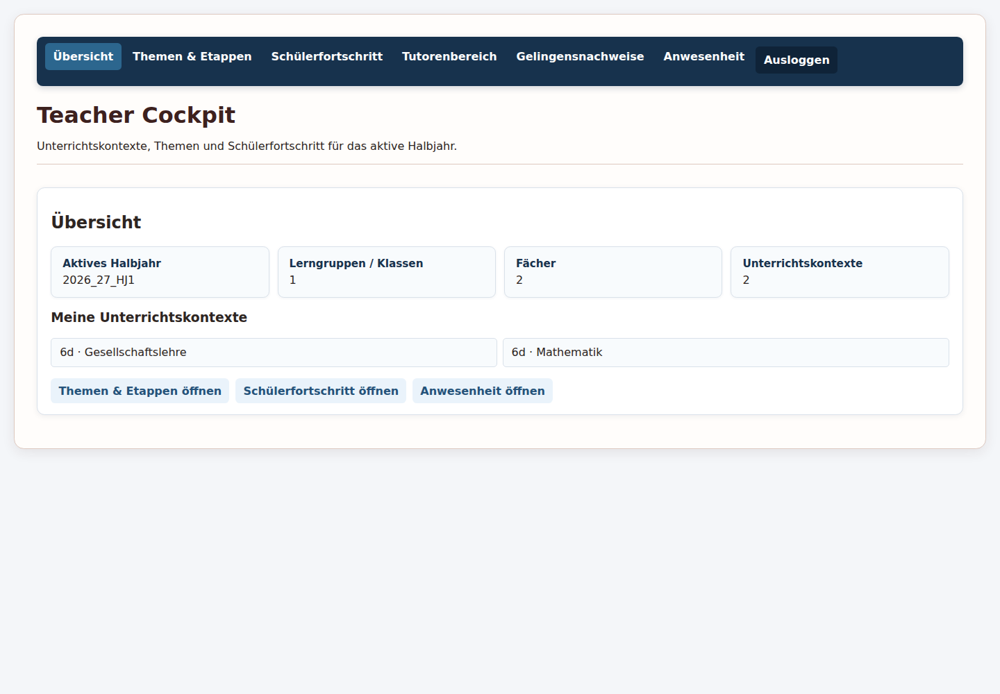
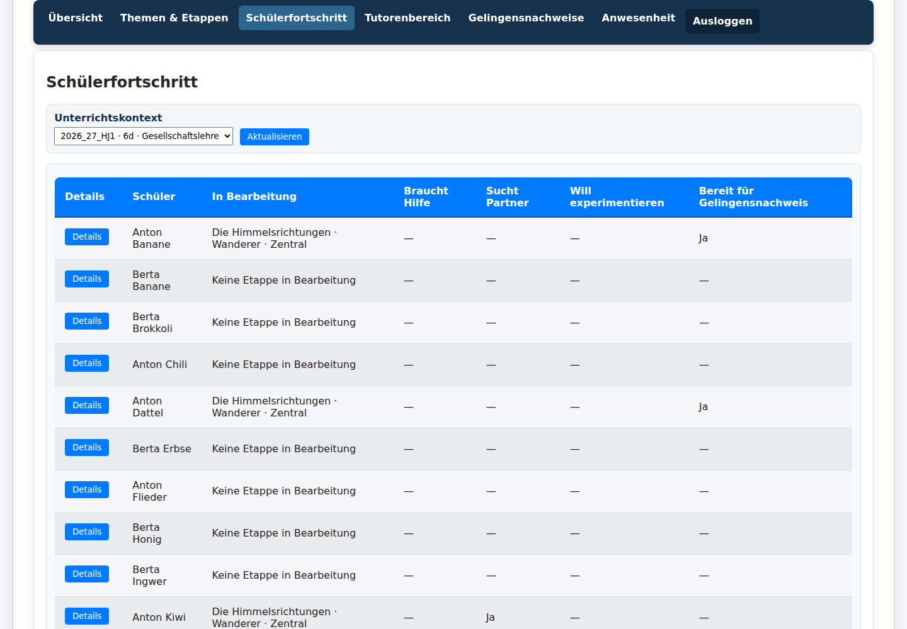

# Arcanum DEMO

Arcanum ist eine Lernumgebung: Schülerinnen und Schüler sehen ihre Fächer,
Etappen, Münzen und ihren aktuellen Lernstand.

## Drei gleichwertige Einstiege

Öffne die [öffentliche DEMO](https://arcanum-demo.dynv6.net/login) am besten
mit Laptop oder Tablet und folge dem passenden vollständigen Rundgang.

Für den Rundgang verwenden wir das synthetische Konto **Anton Apfel
(Klasse 6a)**. Der Login-Name `anton.apfel` steht in der [öffentlichen Zugangsdaten-PDF](Arcanum_DEMO_Zugangsdaten.pdf);
das Passwort wird nicht in Screenshots oder dieser Anleitung wiederholt.

Die DEMO enthält ausschließlich erfundene Testdaten. Sie ist gemeinsam genutzt;
Änderungen anderer Personen können sichtbar sein.

### Schüler

Schülerinnen und Schüler starten mit **Anton Apfel** (`anton.apfel`, Klasse 6a)
und folgen dem [vollständigen Schülerrundgang](docs/rundgang-schueler.de.md).

### Lehrkraft

Lehrkräfte verwenden **Dora Dinkel** (`dora.dinkel`, Tutor-Klasse 6d) und den
[vollständigen Lehrkraftrundgang](docs/rundgang-lehrkraft.de.md). Er zeigt
auch gefüllten Schülerfortschritt, Gelingensnachweise und die Tutorübersicht.

## Gerätehinweis

Für den ersten Rundgang empfehlen wir Laptop oder Tablet. Die Ansichten
funktionieren bei 768 px, 1024 px und 1440 px. Auf sehr schmalen
Smartphone-Displays kann derzeit seitliches Scrollen auftreten.

### Administration

Administratoren verwenden **Ada Ananas** (`ada.ananas`) und den eigenständigen
[Administrationsrundgang](docs/rundgang-administration.de.md). Kritische
Verwaltungsaktionen werden dort erklärt, aber auf der gemeinsam genutzten DEMO
nicht gespeichert.

Alle Konten stehen in der [öffentlichen Zugangsdaten-PDF](Arcanum_DEMO_Zugangsdaten.pdf);
Passwörter werden nicht in dieser README wiederholt.

## Weitere Dokumentation

- [Deutscher Schülerrundgang](docs/handbuch.de.md)
- [Lehrkraft und Administration – bisheriger Überblick](docs/lehrkraft-und-administration.de.md)
- [English documentation](README.en.md)
