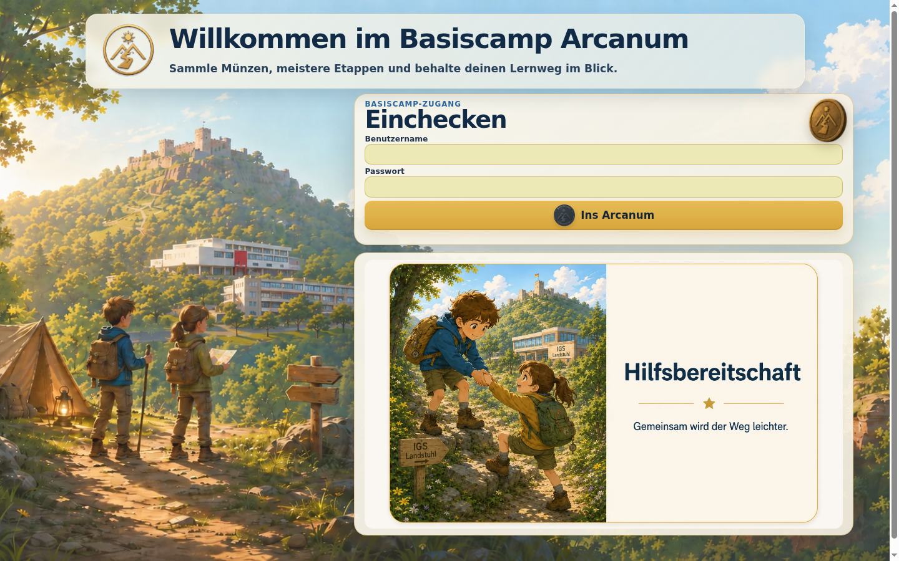
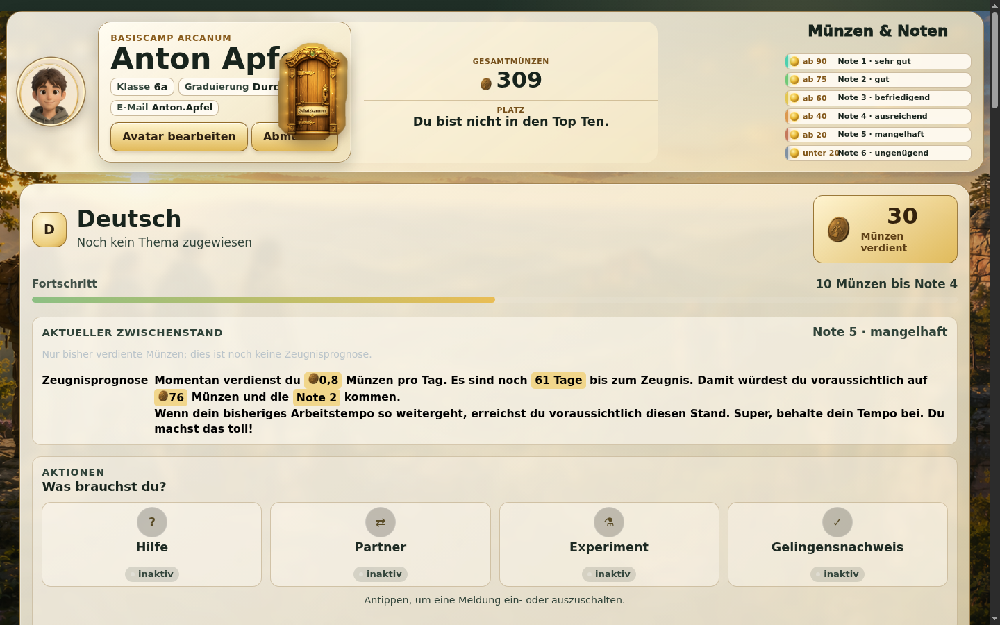
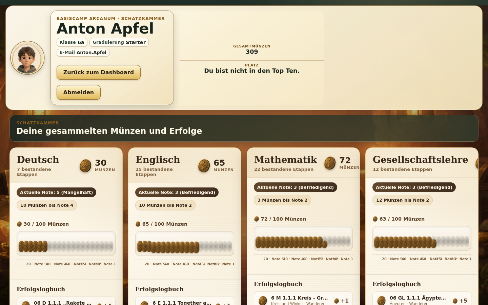
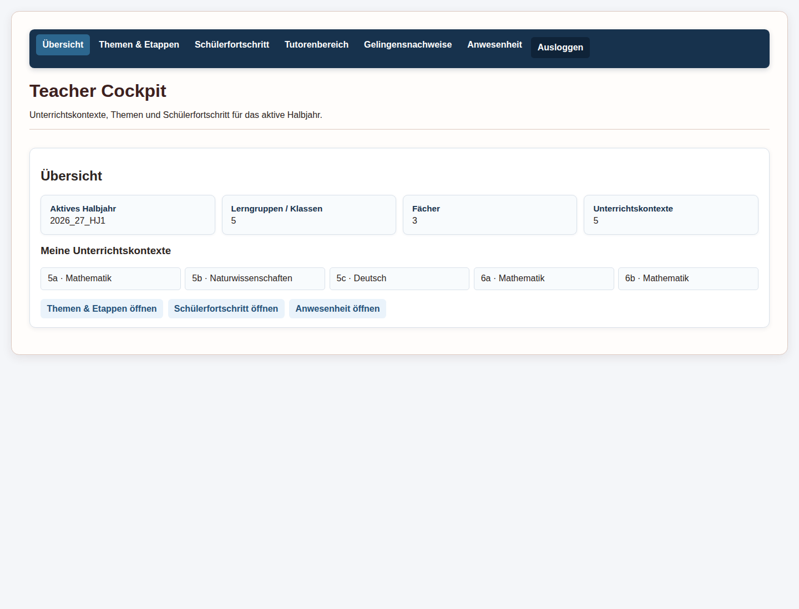
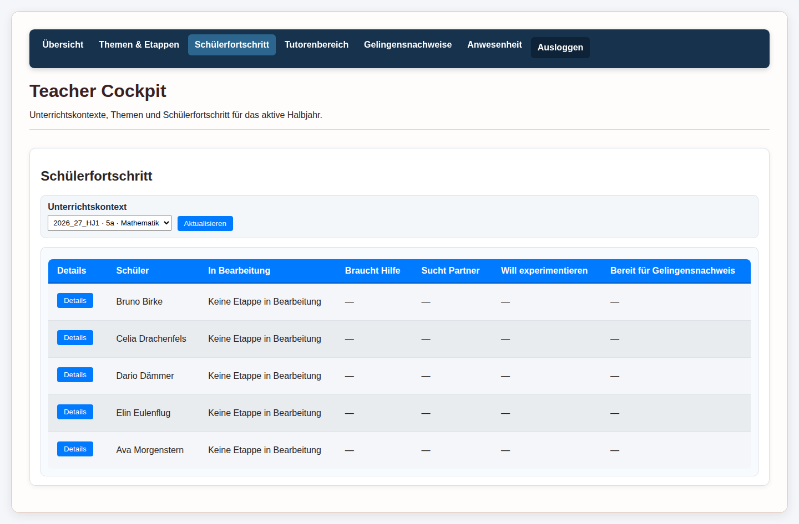

# Arcanum DEMO

Arcanum ist eine Lernumgebung: Schülerinnen und Schüler sehen ihre Fächer,
Etappen, Münzen und ihren aktuellen Lernstand.

## Start hier: geführter Schülerrundgang

Öffne die [öffentliche DEMO](https://arcanum-demo.dynv6.net/login) am besten
mit Laptop oder Tablet und folge dem
[deutschen Anfängerrundgang](docs/handbuch.de.md).

Für den Rundgang verwenden wir das synthetische Konto **Anton Apfel
(Klasse 6a)**. Der Login-Name `anton.apfel` steht in der [öffentlichen Zugangsdaten-PDF](Arcanum_DEMO_Zugangsdaten.pdf);
das Passwort wird nicht in Screenshots oder dieser Anleitung wiederholt.

Die DEMO enthält ausschließlich erfundene Testdaten. Sie ist gemeinsam genutzt;
Änderungen anderer Personen können sichtbar sein.

## Zweiter Einstieg: geführter Lehrkraft-Rundgang

Lehrkräfte finden im [deutschen Lehrkraft-Rundgang](docs/lehrkraft-und-administration.de.md) Schritt für Schritt Teacher Cockpit, Themen & Etappen, Schülerfortschritt, Gelingensnachweise, Tutorenbereich und Anwesenheit. Für den Tutor-Rundgang ist in der PDF **Dora Dinkel** (`dora.dinkel`, Tutor-Klasse 6d) empfohlen.

## Gerätehinweis

Für den ersten Rundgang empfehlen wir Laptop oder Tablet. Die Ansichten
funktionieren bei 768 px, 1024 px und 1440 px. Auf sehr schmalen
Smartphone-Displays kann derzeit seitliches Scrollen auftreten.

## Weitere Rundgänge

- [Deutscher Schülerrundgang](docs/handbuch.de.md)
- [Geführter Lehrkraft-Rundgang](docs/lehrkraft-und-administration.de.md)
- [Lehrkraft und Administration](docs/lehrkraft-und-administration.de.md) (Administrationsüberblick)
- [English documentation](README.en.md)
