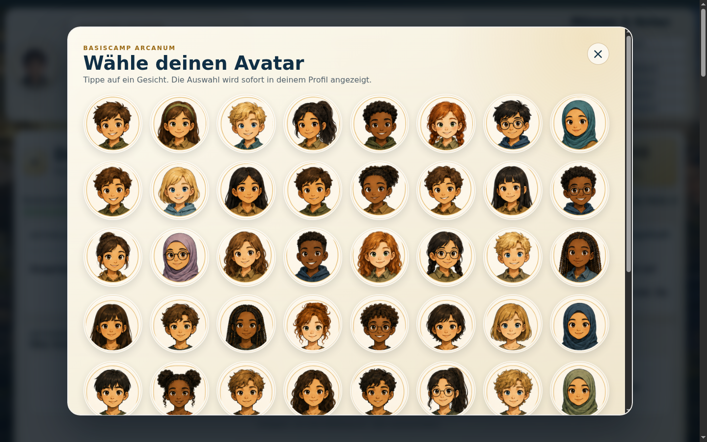
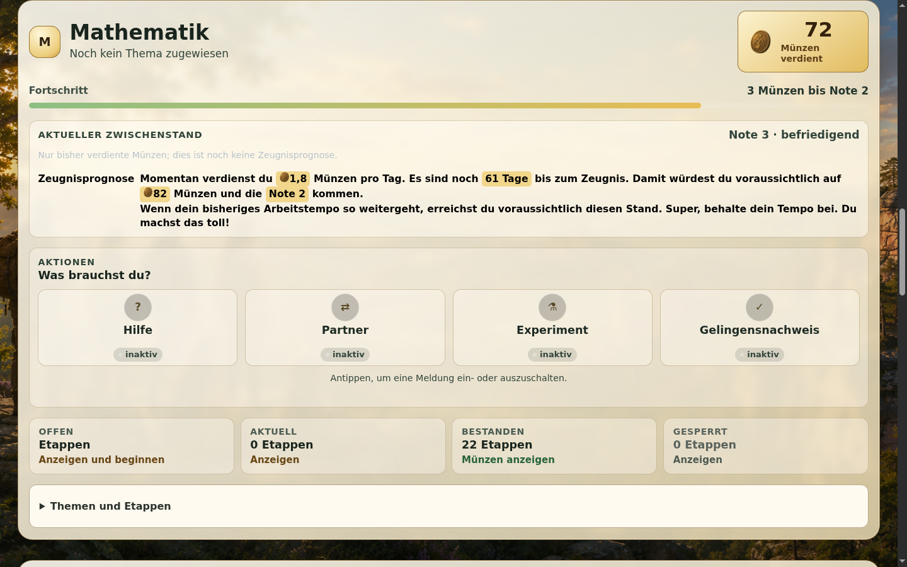
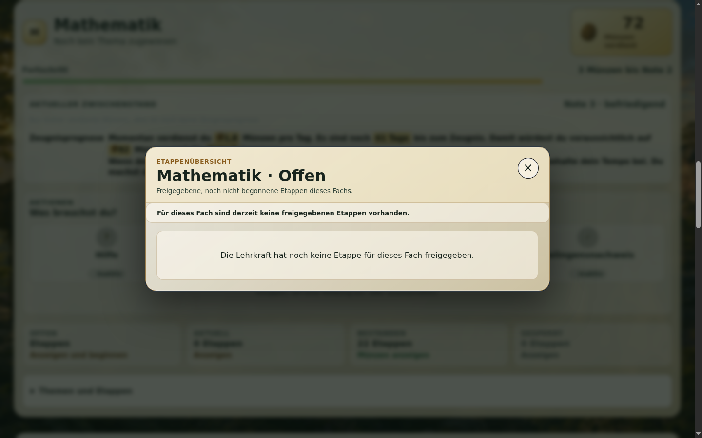
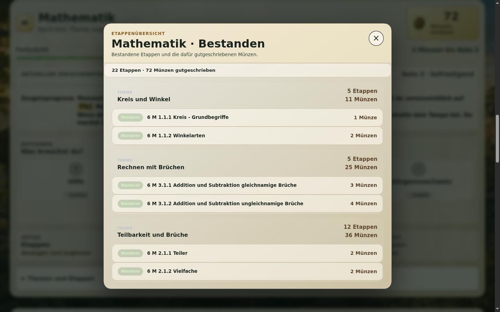
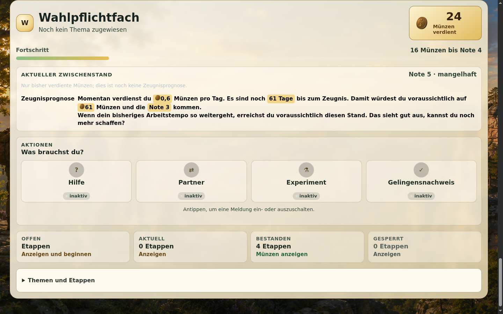

# Arcanum zuerst als Schüler verstehen

**DEMO:** [arcanum-demo.dynv6.net](https://arcanum-demo.dynv6.net/login)
**Öffentliche Konten:** [Arcanum DEMO Zugangsdaten](../Arcanum_DEMO_Zugangsdaten.pdf)

Wir schauen uns Arcanum zuerst aus Sicht eines Schülers an. Der Rundgang nutzt
immer dasselbe synthetische Konto: **Anton Apfel, Klasse 6a**. Der Name ist ein
frei erfundener DEMO-Account. Die gemeinsame DEMO kann sich verändern.

## 1. Was ist Arcanum?

Arcanum zeigt Lerninhalte in Fächern und Etappen. Schülerinnen und Schüler
sehen, was sie bearbeiten können, was bereits bestanden ist, wie viele Münzen
sie verdient haben und welcher aktuelle Lernstand daraus entsteht. Außerdem
zeigt die DEMO eine Prognose und die gesammelten Erfolge in der Schatzkammer.

Für den ersten Rundgang ist ein Laptop oder Tablet am übersichtlichsten. Die
Ansichten funktionieren bei 768 px, 1024 px und 1440 px. Auf sehr schmalen
Smartphone-Displays kann derzeit seitliches Scrollen auftreten.

## 2. Anmelden

Öffne die DEMO und verwende das Schülerkonto **Anton Apfel (6a)** aus der
öffentlichen PDF. Der Login-Name ist `Anton.Apfel`. Das Passwort bleibt in der
PDF und wird hier nicht wiederholt.

Die Anmeldung braucht nur Login-Name und Passwort. Nach der Anmeldung öffnet
sich das Schülerdashboard. Die Aufnahme zeigt bewusst keine eingegebenen
Zugangsdaten.

## 3. Das Dashboard auf einen Blick

Orientiere dich zunächst an drei Ebenen:

- **Oben:** Wer bin ich, zu welcher Klasse gehöre ich und wie viele Münzen habe ich?
- **In der Mitte:** Wie ist mein Stand insgesamt und in einem Fach?
- **Fachkarten:** Was kann ich bearbeiten, was habe ich erreicht und wobei kann ich Hilfe anfordern?

Anton sieht reguläre Fächer und ein individuelles WPF-Fach. In der DEMO
erscheinen nur aktuell verwendete Fächer, für die auch Etappen vorhanden sind.
Deshalb gibt es keine leeren Platzhalterkarten.

## 4. Profilbereich von oben nach unten

### Name und Klasse

Der Name identifiziert das DEMO-Konto. Die Klasse — hier **6a** — bestimmt den
schulischen Kontext, in dem reguläre Lerninhalte und Zuordnungen gelten.

### Graduierung

Anton zeigt hier die Graduierung **Durchstarter**. Sie beschreibt
Selbstständigkeit und Verantwortung im Lernweg. Sie ist nicht dasselbe wie das
akademische Etappen-Niveau Wanderer, Bergsteiger oder Gipfelstürmer.

### Rang

Der Rang vergleicht deine Gesamtmünzen mit den aktiven Schülerinnen und
Schülern deines Jahrgangs im aktuellen Halbjahr. Haben mehrere dieselbe
Münzzahl, erhalten sie denselben Rang. Im Livebild steht: **„Du bist nicht in
den Top Ten.“** Das ist eine Ranginformation, keine Note.

### Avatar

Mit **Avatar bearbeiten** öffnet sich die Auswahl. Ein Gesicht anklicken ändert
den Avatar sofort; einen zusätzlichen Speichern-Knopf gibt es nicht. Die
Auswahl wird derzeit nur in diesem Browser für dieses DEMO-Konto gespeichert,
nicht als serverseitige Profileinstellung. In einem anderen Browser oder auf
einem anderen Gerät kann deshalb wieder ein anderer oder der Standard-Avatar
erscheinen. Der Avatar verändert weder Münzen noch Noten, Rang, Etappen oder
Prognosen. Im Rundgang wurde keine Auswahl gespeichert.

## 5. Eine reguläre Fachkarte: Mathematik

Die Mathematik-Karte ist unser konkrete Beispiel. Im geprüften Livebild
standen dort 72 verdiente Münzen, der aktuelle Zwischenstand war **Note 3 ·
befriedigend**, und es fehlten 3 Münzen bis Note 2.

Von oben nach unten bedeutet die Karte:

- **Fachname:** Mathematik.
- **Münzen verdient:** bestätigte Leistung in diesem Fach.
- **Fortschritt:** Der Balken zeigt, wie weit du innerhalb deiner aktuellen
  Notenstufe auf dem Weg zur nächsten Note bist. Der Text daneben nennt die
  genaue Zahl der noch fehlenden Münzen.
- **Aktueller Zwischenstand:** Note aus den bisher verdienten Münzen.
- **Zeugnisprognose:** mögliche Entwicklung, wenn das bisherige Tempo anhält.
- **Aktionen:** vier Meldungen, die der Schüler ein- und ausschalten kann.
- **Etappenstatus:** Offen, Aktuell, Bestanden und Gesperrt.
- **Themen und Etappen:** der fachliche Lernplan.

### Münzen

Eine Münze steht für bestätigte akademische Leistung. Das bloße Öffnen oder
Beginnen einer Etappe verdient noch keine Münze. Zentrale und flexible Etappen
tragen zum selben Fachkonto bei. Bei einer variablen flexiblen Etappe können
maximal mögliche und tatsächlich verliehene Münzen unterschiedlich sein, zum
Beispiel „2 von 4 Münzen“.

### Aktueller Zwischenstand

| Verdiente Münzen | Aktuelle Note |
|---:|:---|
| ab 90 | 1 · sehr gut |
| ab 75 | 2 · gut |
| ab 60 | 3 · befriedigend |
| ab 40 | 4 · ausreichend |
| ab 20 | 5 · mangelhaft |
| unter 20 | 6 · ungenügend |

Der aktuelle Zwischenstand ist nicht die Prognose. Anton hatte in Mathematik
Note 3 bei 72 Münzen; die Live-Prognose lag bei 82 Münzen und Note 2.

### Prognose

Die Prognose kombiniert den bisherigen Münz-Zuwachs, die verbleibenden Tage
bis zum Zeugnis und den daraus errechneten voraussichtlichen Münzstand. Sie ist
eine Wenn-dann-Rechnung, keine bereits eingetragene Zeugnisnote. Bei Anton
lautete sie im Livebild: 1,8 Münzen pro Tag, voraussichtlich 82 Münzen und Note
2. Fachkarten ohne ausreichende Verlaufsdaten können keine sinnvolle Prognose
anzeigen.

## 6. Die vier Aktionsschaltflächen

Diese vier Schaltflächen sind Meldungen und nicht die Etappenstatus darunter.
Im geprüften Anton-Konto standen alle auf **inaktiv**. Ein Klick speichert die
Meldung; ein erneuter Klick nimmt sie zurück. Das ist eine gemeinsame DEMO-
Änderung.

- **Hilfe:** Der Schüler bittet für dieses Fach um Hilfe. Aktiv bedeutet, dass die Hilfeanforderung gespeichert ist.
- **Partner:** Der Schüler schaltet die Partnersuche für das Fach ein oder aus. Gibt es keinen passenden Partner, erscheint kein erfundener Treffer.
- **Experiment:** Der Schüler fordert Betreuung für ein Experiment an. Das Signal ist keine abgeschlossene Leistung.
- **Gelingensnachweis:** Der Schüler meldet Bereitschaft für einen Gelingensnachweis. Das ist kein Selbst-„Bestanden“; eine Lehrkraft bearbeitet den Nachweis.

Die sichtbaren Texte „aktiv“ und „inaktiv“ zeigen den gespeicherten Zustand.

## 7. Etappenstatus

Die zweite Gruppe beschreibt den Lernstand einer Etappe:

- **Offen:** Etappen, die noch erreichbar sind. **Anzeigen und beginnen** öffnet die Liste; dort kann eine Etappe begonnen werden.
- **Aktuell:** Etappen, die der Schüler derzeit bearbeitet. Im gewählten Konto waren es im Livebild 0.
- **Bestanden:** bestätigte Etappen mit den gutgeschriebenen Münzen.
- **Gesperrt:** Etappen, die derzeit nicht bearbeitet werden können. Die Freigabe hängt vom Lernweg und den zuständigen schulischen Rollen ab.

Eine begonnene Etappe ist noch nicht bestanden. Erst die bestätigte Leistung
erscheint unter **Bestanden** und zählt als verdiente Münze.

## 8. Themen und Etappen

Unter **Themen und Etappen** zeigt Arcanum den Lernplan: Thema, Etappentitel,
Niveau, Münzwert und Status. Zentrale Etappen gehören zum gemeinsamen
Curriculum für Fach und Jahrgang. Flexible Etappen kommen aus dem zugeordneten
Lernkontext. Beide Arten zählen in derselben Fachkarte.

Die Niveaus bedeuten: **Wanderer** (1), **Bergsteiger** (2) und
**Gipfelstürmer** (3). Das Niveau beschreibt die akademische Anforderung. Die
Graduierung im Profil beschreibt dagegen Selbstständigkeit und Verantwortung.

## 9. Reguläre und individuelle Fächer

### Regulär

Reguläre Fächer sind die normalen Fächer der Klasse im aktuellen SOL-Kontext.
Anton sieht zum Beispiel Deutsch, Englisch, Mathematik,
Gesellschaftslehre und Naturwissenschaften.

### Individuell

Anton hat zusätzlich ein individuelles WPF-Fach. Nicht jeder Schüler hat das
gleiche individuelle Fach; die Zuordnung gehört zum jeweiligen DEMO-Konto. Nur
dieses zugeordnete Fach erscheint. „Individuell“ bedeutet nicht leichter oder
schwerer — Münzen, Etappen und Noten folgen demselben Lernmodell.

## 10. Zentrale und flexible Etappen

- **Zentral:** gemeinsamer Lernplan für Fach und Jahrgang.
- **Flexibel:** zusätzlicher Lernweg aus dem zugeordneten Kontext.

Beide können zum Münzstand des Faches beitragen. Bei einer variablen flexiblen
Etappe wird der konkrete Wert erst bei der bestätigten Leistung festgelegt und
bleibt innerhalb des vorgesehenen Maximums.

## 11. Schatzkammer

Die Schatzkammer beantwortet: **Was habe ich insgesamt gesammelt und erreicht?**

Oben stehen der Schüler, die Klasse, die Graduierung, die Gesamtmünzen und der
Rang. **Zurück zum Dashboard** führt zurück; **Abmelden** beendet die Sitzung.

Für jedes Fach zeigt die Schatzkammer:

- den Fachnamen und die Zahl der bestandenen Etappen,
- die verdienten Münzen,
- die aktuelle Note und die genaue Zahl der Münzen bis zur nächsten Note,
- die Münzstapel mit verdienten und noch offenen Plätzen.

Die Münzstapel zeigen den Weg bis 100 Münzen. Bereits verdiente Münzen sind
gefüllt, noch offene Plätze bleiben frei. Die Markierungen ordnen die Noten ein:
20 Münzen entsprechen Note 5, 40 Note 4, 60 Note 3, 75 Note 2 und 90 Note 1.
Wenn der Browser beim Überfahren weitere Informationen zeigt, nennt der Titel
einer verdienten Münze auch die Etappe, aus der sie stammt.

Das **Erfolgslogbuch** beantwortet die Frage: **Welche bestandenen Etappen
haben diese Münzen erzeugt?** Es nennt den Namen der Etappe, wenn vorhanden das
Thema und das Niveau, sowie die verliehene Belohnung. Bei variablen flexiblen
Etappen kann dort zum Beispiel **„2 von 4 Münzen“** stehen: Die Etappe konnte
bis zu vier Münzen bringen, tatsächlich wurden aber zwei gutgeschrieben.

Im aktuellen DEMO-Stand kann Niveau 1 im Erfolgslogbuch noch fälschlich als
**„Starter“** erscheinen; fachlich ist damit **„Wanderer“** gemeint. Die
fachlichen Niveaus heißen Wanderer, Bergsteiger und Gipfelstürmer.

Hier kann der Schüler keine Note frei eingeben; Änderungen entstehen durch
bestätigte Etappen im Lernweg.

Der Unterschied der Ansichten:

- **Dashboard:** Was bearbeite ich gerade und wie geht es mir jetzt?
- **Fachkarte:** Was passiert in diesem einen Fach?
- **Schatzkammer:** Was habe ich insgesamt gesammelt und erreicht?

## 12. Danach: Lehrkraft und Administration

Der Einsteiger-Rundgang endet bewusst beim Schüler. Die getrennte
[Lehrkraft- und Administrationsanleitung](lehrkraft-und-administration.de.md)
behandelt danach Teacher Cockpit, Schülerfortschritt, Gelingensnachweise,
Tutorbereich, Anwesenheit, Schuljahr, Curriculum und Berechtigungen.

## Begriffe und Sicherheit

Alle Konten und Daten der DEMO sind synthetisch. Keine PROD-Zugangsdaten,
Passwörter, Tokens oder privaten Daten gehören in Screenshots. Die DEMO ist
gemeinsam genutzt: Bitte nur lesen, ansehen und Vorschauen verwenden.
