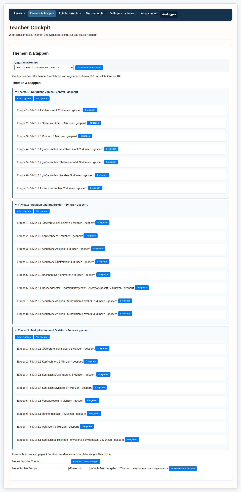
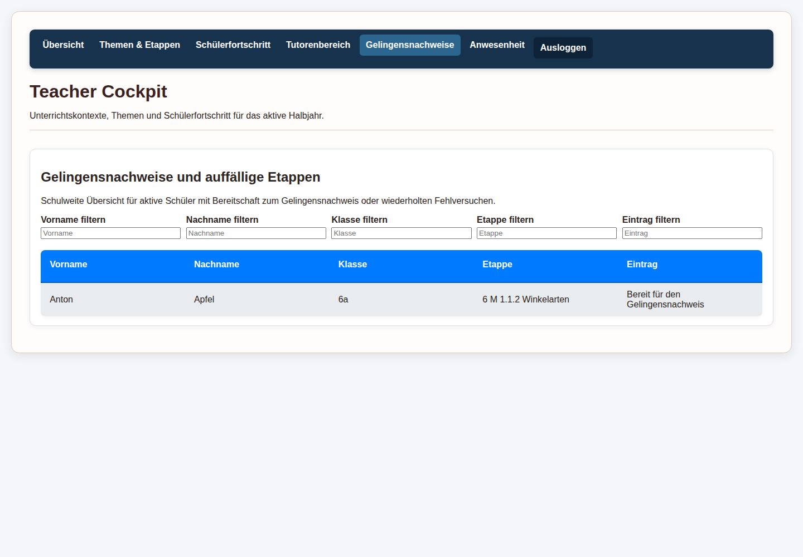
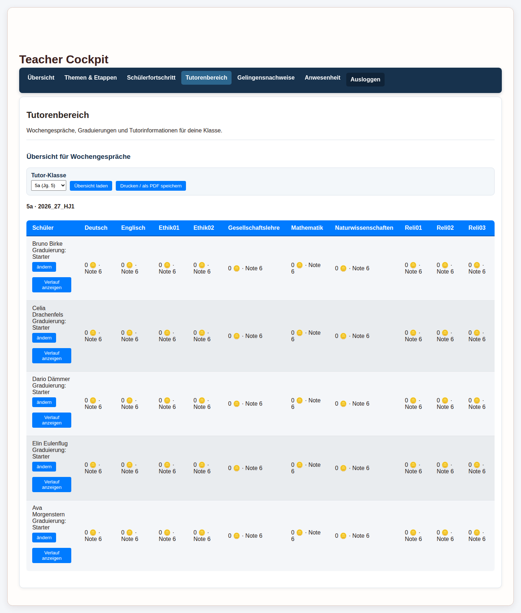
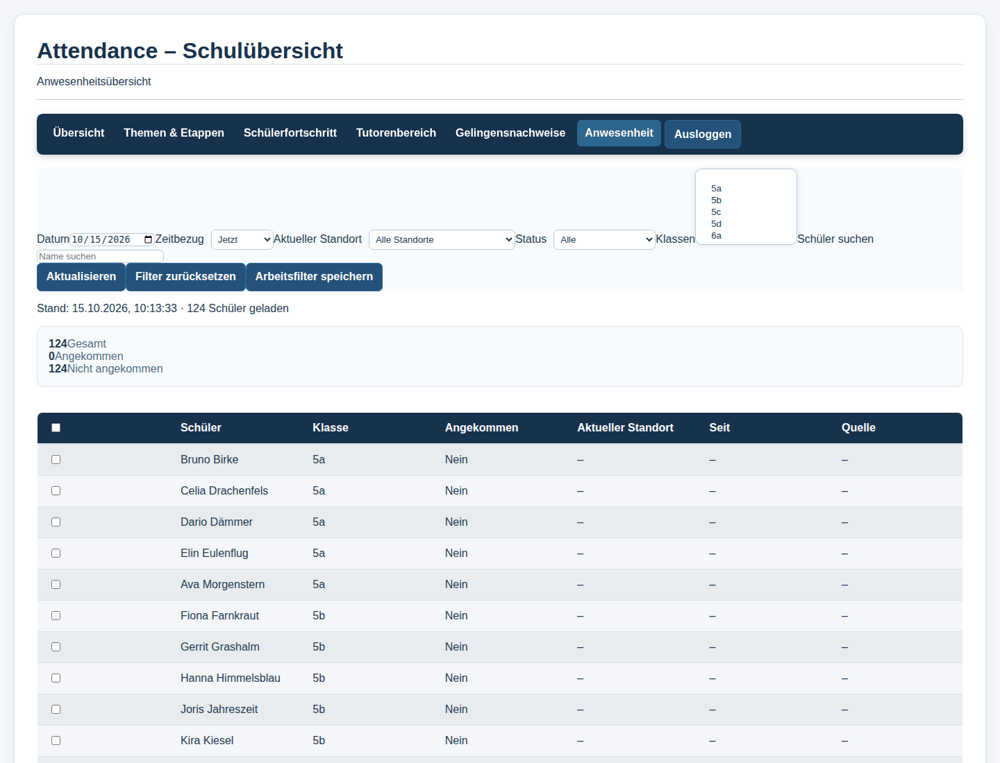

# Lehrkraft-Rundgang durch die Arcanum-DEMO

> **Aktueller vollständiger Stand:** Verwende den [neuen Lehrkraftrundgang](rundgang-lehrkraft.de.md)
> und den [eigenständigen Administrationsrundgang](rundgang-administration.de.md).
> Diese Datei bleibt als bisheriger Überblick erhalten.

Diese Anleitung ist der zweite Einstieg nach dem [deutschen Schülerrundgang](handbuch.de.md). Sie führt Schritt für Schritt durch die Bereiche, die eine Lehrkraft im **Teacher Cockpit** (Lehrkraft-Übersicht) für den Unterrichtsalltag braucht.

Die Aufnahmen stammen aus einem echten DEMO-Abnahmelauf. Die DEMO ist gemeinsam genutzt; Namen, Klassen, Etappen und Zähler können sich deshalb ändern. Die Konten und Namen in den Bildern sind synthetisch. Das Lehrkraftkonto wird ausschließlich in der öffentlichen [Zugangsdaten-PDF](../Arcanum_DEMO_Zugangsdaten.pdf) nachgeschlagen. Das Passwort wird hier weder wiederholt noch in Screenshots eingegeben.

## 1. Sicher starten

1. Öffne die [öffentliche DEMO](https://arcanum-demo.dynv6.net/login).
2. Verwende für den vollständigen Rundgang das synthetische Lehrkraftkonto **Dora Dinkel** (`dora.dinkel`) aus der öffentlichen PDF. Es ist der geprüfte Tutor-Einstieg für Klasse 6d. Der Benutzername steht in der PDF; das Passwort wird hier nicht wiederholt.
3. Melde dich an. Prüfe nach dem Login, dass oben die Navigation des Teacher Cockpits mit **Übersicht**, **Themen & Etappen**, **Schülerfortschritt**, **Tutorenbereich**, **Gelingensnachweise** und **Anwesenheit** erscheint.
4. Klicke für die Besichtigung nur auf Navigation, Auswahlfelder, **Anzeigen/Aktualisieren** und reine Detailansichten. Verwende keine Schaltflächen mit **Freigeben**, **Sperren**, **Bestätigen**, **Speichern**, **Ändern**, **Zurücknehmen**, **Anlegen** oder **Löschen**.

Die Navigation führt immer durch dieselbe Lehrkraftsitzung. Ein Wechsel des Bereichs ist eine reine Ansicht. Das Abmelden beendet dagegen die Sitzung; es verändert keine Unterrichtsdaten.

## 2. Das Modell hinter den Ansichten

Arcanum verbindet Schülerarbeit, Etappen und Fachstand in einer einfachen Kette:

`Unterrichtskontext → Thema → Etappe → bestätigte Leistung → Münzen → Fachstand`

Ein **Unterrichtskontext** verbindet Halbjahr, Klasse/Lerngruppe, Fach und zuständige Lehrkraft. Er entscheidet, welche Schüler- und Curriculumdaten eine Lehrkraft sehen darf.

Ein **Thema** bündelt mehrere **Etappen**. Eine Etappe ist ein konkreter Lernschritt. Eine sichtbare Etappe kann zentral aus dem gemeinsamen Curriculum stammen oder flexibel für den Unterrichtskontext angelegt sein.

Wichtig für die Einordnung:

- Das Öffnen oder Beginnen einer Etappe ist noch keine bestätigte Leistung.
- Erst eine bestätigte Leistung erzeugt verdiente Münzen. Die Münzen fließen in das Fachkonto des Schülers ein.
- Der Fachstand ergibt daraus den aktuellen Noten-Zwischenstand und gegebenenfalls eine Prognose. Eine Prognose ist keine eingetragene Zeugnisnote.
- **Wanderer**, **Bergsteiger** und **Gipfelstürmer** sind akademische Niveaus einer Etappe. Die **Graduierung** eines Schülers beschreibt dagegen Selbstständigkeit und Verantwortung. Beides darf nicht verwechselt werden.
- Die Schüleraktionen **Hilfe**, **Partner**, **Experiment** und **Gelingensnachweis** sind Signale für die Lehrkraft. Sie sind nicht dasselbe wie eine bestandene Etappe.

## 3. Übersicht: das Teacher Cockpit

Nach dem Login öffnet sich **Übersicht**. Oben stehen die sechs Wege durch das Cockpit. In der Übersicht darunter zeigt Arcanum das aktive Halbjahr, die Zahl der Lerngruppen/Klassen, die Fächer und die Unterrichtskontexte der Lehrkraft.

### So liest du die Seite

- **Aktives Halbjahr:** Alle folgenden Ansichten beziehen sich zunächst auf diesen zeitlichen Rahmen.
- **Lerngruppen/Klassen:** Gruppen, in denen die Lehrkraft einen Unterrichtskontext besitzt.
- **Fächer:** Fächer, die in diesen Kontexten vorkommen.
- **Unterrichtskontexte:** Die konkrete Kombination aus Halbjahr, Klasse/Lerngruppe, Fach und Zuständigkeit.
- **Meine Unterrichtskontexte:** Die einzelnen Kacheln helfen, den passenden Kontext auszuwählen.

Die Schaltflächen **Themen & Etappen öffnen**, **Schülerfortschritt öffnen** und **Anwesenheit öffnen** führen in die jeweilige Ansicht. Die obere Navigation ist gleichwertig und meist übersichtlicher, wenn du zwischen mehreren Bereichen wechselst.

### Abhängigkeit von der Zuordnung

Eine Lehrkraft sieht nicht automatisch jede Klasse und jedes Fach der Schule. Die Liste wird aus ihren Unterrichtszuordnungen und dem aktiven Halbjahr gebildet. Fehlt ein Fach oder eine Klasse, ist das zunächst ein Hinweis auf die Zuordnung, nicht auf einen leeren Lernstand.

## 4. Themen & Etappen: den Lernplan lesen

Wähle oben **Themen & Etappen**. Oben im Inhalt erscheint der Filter **Unterrichtskontext**. Wähle einen Kontext und klicke auf **Anzeigen/Aktualisieren**. Im geprüften Lehrkraftbereich wird der vollständige Unterrichtskontext verwendet; Klasse und Fach werden daraus abgeleitet.

### Was du siehst

- Die Zeile **Geplant** fasst den Münzrahmen des ausgewählten Kontexts zusammen. Sie zeigt zentrale und flexible Planung sowie den regulären Rahmen und die absolute technische Grenze.
- Darunter stehen die Themen. Ein aufgeklapptes Thema zeigt seine Etappen.
- Jede Etappe enthält ihre sichtbare Nummer, das akademische Niveau, den Titel, die geplanten Münzen und den Status.
- **Zentral** bezeichnet gemeinsamen Curriculum-Inhalt. **Flexibel** bezeichnet einen zusätzlichen, kontextbezogenen Lernweg.
- **Gesperrt** oder **freigegeben** beschreibt den Bearbeitungszugang für Schüler. Es ist kein Leistungsurteil.

Die Niveaubezeichnung in der Etappe ist fachlich: Wanderer, Bergsteiger oder Gipfelstürmer. Die Graduierung aus dem Profil des Schülers ist davon getrennt.

### Gefahrlos betrachten

Du kannst Fach und Kontext auswählen, Themen auf- und zuklappen und die vorhandenen Titel, Statuswerte und Münzwerte lesen. Das sind reine Ansichten.

### Aktionen mit Wirkung

**Freigeben**, **Alle freigeben**, **Sperren** und **Alle sperren** verändern den Zugang für Schüler. Neue flexible Themen oder Etappen anzulegen, Münzen zu ändern oder Inhalte zu löschen verändert ebenfalls DEMO-Daten. Für diesen Rundgang werden diese Aktionen nicht verwendet.

Die sichtbaren Münzen sind ein Planwert beziehungsweise ein möglicher Leistungswert. Sie werden nicht dadurch verdient, dass eine Lehrkraft die Liste öffnet.

## 5. Schülerfortschritt: Lernwege nachvollziehen

Wähle **Schülerfortschritt** und anschließend einen Unterrichtskontext. Mit **Aktualisieren** lädst du die zugeordneten Schüler und ihre Signale. Wenn einem Kontext aktuell keine Schüler zugeordnet sind, zeigt die DEMO stattdessen ausdrücklich eine leere Ansicht an.

Wenn Schüler zugeordnet sind, ordnet die Tabelle die Informationen pro Schüler:

- **Details:** Öffnet die Detailansicht des ausgewählten Schülers im Kontext.
- **In Bearbeitung:** Zeigt, ob eine Etappe aktuell bearbeitet wird.
- **Braucht Hilfe:** Das Hilfe-Signal aus der Fachkarte.
- **Sucht Partner:** Das Partnersignal.
- **Will experimentieren:** Das Signal für Betreuungsbedarf bei einem Experiment.
- **Bereit für Gelingensnachweis:** Die Meldung des Schülers, dass er sich für einen Nachweis bereit fühlt.

Ein Gedankenstrich bedeutet: Für diesen Kontext liegt aktuell kein entsprechendes Signal vor. **Keine Etappe in Bearbeitung** bedeutet nicht, dass der Schüler nichts gelernt hat; bestandene Etappen und Münzen werden in den passenden Detail- und Fachansichten betrachtet. Die bei der Browserabnahme sichtbare Meldung **Für diesen Unterrichtskontext sind keine Schüler zugeordnet** ist ein gültiger Datenzustand und kein Fehler der Seite.

### Pädagogische Verwendung

Die Seite ist eine Gesprächs- und Planungshilfe. Eine Lehrkraft kann zunächst nach Unterrichtskontext sortieren, Signale wahrnehmen und anschließend mit **Details** einen Schülerfall genauer ansehen. Die Tabelle ersetzt kein pädagogisches Urteil und ist keine Rangliste.

### Was die Lehrkraft hier nicht tut

Der Rundgang verändert keine Schülerarbeit. Das Öffnen der Details ist unbedenklich; Bewertungen, Fortschrittsänderungen oder andere Speichervorgänge gehören in eine gesonderte, bewusst vorbereitete Unterrichtssituation.

## 6. Gelingensnachweise: Bereitschaft einordnen

Wähle **Gelingensnachweise**. Die Seite heißt **Gelingensnachweise und auffällige Etappen** und bietet eine schulweite Übersicht aktiver Schüler, die für einen Gelingensnachweis bereit sind oder bei einer Etappe wiederholt Schwierigkeiten zeigen. Wenn aktuell keine passenden Einträge vorhanden sind, bleibt die Tabelle leer und zeigt dies ausdrücklich an.

Oben stehen die Lesefilter **Vorname**, **Nachname**, **Klasse**, **Etappe** und **Eintrag**. Ein Filter schränkt nur die angezeigte Liste ein; er bestätigt keinen Nachweis und setzt keinen Schülerstatus.

In der Tabelle bedeuten die Spalten:

- **Vorname**, **Nachname** und **Klasse:** der synthetische Schülerkontext;
- **Etappe:** die konkrete Etappe, auf die sich der Eintrag bezieht;
- **Eintrag:** das Signal oder der Hinweis, zum Beispiel „Bereit für den Gelingensnachweis“.

Ein Gelingensnachweis ist ein pädagogischer Prüfungsschritt. Die Meldung „bereit“ ist eine Bitte beziehungsweise Bereitschaftsanzeige, kein automatisch bestandenes Ergebnis und keine automatische Münzgutschrift. Eine Lehrkraft muss den Nachweis fachlich begleiten und die dafür vorgesehenen, bewusst bestätigenden Arbeitsabläufe verwenden.

## 7. Tutorenbereich: die eigene Klasse im Blick behalten

Wähle **Tutorenbereich**. Für diesen Rundgang ist **Dora Dinkel** (`dora.dinkel`) vorgesehen: Das Konto ist der Klasse **6d** als Tutor-Lehrkraft zugeordnet. Beim geprüften Aufruf erscheinen 25 Schülerinnen und Schüler. Dieser Bereich ist nur sinnvoll gefüllt, wenn das Lehrkraftkonto einer Tutor-Klasse zugeordnet ist.

Wähle im Feld **Tutor-Klasse** eine angebotene Klasse und klicke auf **Übersicht laden**. Bei passender Curriculum-Zuordnung zeigt die Ansicht eine Wochenübersicht für Gespräche sowie pro Schüler die fachbezogenen Münzen, Noten und die Graduierung. Passt die Tutor-Klasse nicht zum aktuellen Curriculum-Kontext des Kontos, zeigt die DEMO stattdessen einen entsprechenden Hinweis; das ist kein Grund, Daten zu ändern oder eine andere Rolle zu verwenden.

### So liest du die Übersicht

- Die Überschrift nennt Klasse und aktives Halbjahr.
- Jede Zeile gehört zu einem Schüler.
- In den Fachspalten stehen der aktuelle Münzstand und die daraus abgeleitete Note.
- **Graduierung** steht beim Schülernamen und ist unabhängig vom akademischen Etappen-Niveau.
- **Verlauf anzeigen** öffnet den zeitlichen Lernverlauf zur Betrachtung.
- **ändern** ist eine bearbeitende Funktion für die Graduierung und wird im Rundgang nicht verwendet.

Die Schaltfläche **Drucken / als PDF speichern** erzeugt eine Ausgabe für die eigene Arbeit. Sie ist kein Ersatz für eine Datenschutzprüfung: Eine exportierte Übersicht kann Schülerdaten enthalten und darf nur sicher gespeichert oder geteilt werden.

### Warum der Bereich anders aussieht

Der Tutorenbereich bündelt Klasseninformationen für Gespräche. Er ist deshalb breiter und stärker tabellarisch als das Cockpit. Fehlt eine Klasse im Auswahlfeld, fehlt dem Konto die passende Tutorzuordnung oder der Kontext gehört nicht zum aktiven Halbjahr.

## 8. Anwesenheit: Übersicht lesen, nichts bestätigen

Wähle **Anwesenheit**. Die Seite zeigt eine schulweite Schülerübersicht mit Filtern und einer Zusammenfassung.

### Die Filter

- **Datum:** der Tag, für den die Anwesenheit betrachtet wird;
- **Zeitbezug:** zum Beispiel die aktuelle Sicht beziehungsweise ein anderer angebotener Zeitbezug;
- **Aktueller Standort:** Filter nach dem hinterlegten Standort;
- **Status:** etwa alle, angekommen oder nicht angekommen;
- **Klassen:** Auswahl einer oder mehrerer Klassen;
- **Schüler suchen:** Namenssuche innerhalb der Liste.

Mit **Aktualisieren** lädst du die Filteransicht. **Filter zurücksetzen** stellt die neutrale Sicht wieder her. Beides ändert keine Anwesenheitsdaten.

Die Kennzahlen **Gesamt**, **Angekommen** und **Nicht angekommen** beziehen sich auf die aktuell ausgewählte Sicht. In der Tabelle stehen Schüler, Klasse, Ankunftsstatus, aktueller Standort, Zeitpunkt und Quelle.

### Sicherheitsgrenze

**Als anwesend bestätigen** ist eine zustandsverändernde Aktion. Sie schreibt einen Anwesenheitsstatus. Auch **Arbeitsfilter speichern** kann eine Einstellung dauerhaft ablegen. Im öffentlichen Rundgang werden beide Schaltflächen nicht verwendet; die Seite wird nur gelesen und gefiltert.

## 9. Die Zusammenhänge an einem Beispiel

Eine Schülerin bearbeitet eine freigegebene Etappe in Mathematik. Das Bearbeiten erscheint gegebenenfalls im Schülerfortschritt als „in Bearbeitung“. Erst wenn die Leistung bestätigt wurde, wird sie als bestandene Etappe geführt und die vorgesehenen Münzen werden dem Fachkonto gutgeschrieben.

Die Lehrkraft kann danach verschiedene Fragen an unterschiedlichen Stellen beantworten:

- **Themen & Etappen:** Welche Lernschritte sind geplant, zentral oder flexibel, und welche sind für die Klasse freigegeben?
- **Schülerfortschritt:** Wer arbeitet gerade woran und wer hat um Hilfe, Partner oder einen Gelingensnachweis gebeten?
- **Gelingensnachweise:** Für welche Etappe liegt eine Bereitschaftsmeldung oder ein auffälliger Verlauf vor?
- **Tutorenbereich:** Wie sieht der Gesprächsanlass in der eigenen Klasse über Fächer hinweg aus?
- **Anwesenheit:** Wer ist für den gewählten Tag und die gewählten Filter angekommen?

Die Münzen verbinden Lernweg und Fachstand. Sie sind keine Anwesenheitsmarken und kein direkter Ersatz für die fachliche Beurteilung. Die akademischen Niveaus Wanderer, Bergsteiger und Gipfelstürmer beschreiben die Anforderung der Etappe; die Graduierung bleibt eine separate Information aus dem Tutor-/Schülerkontext.

## 10. Was in der Administration bewusst noch fehlt

Der bisherige Administrationsüberblick bleibt erhalten. Die Administration umfasst Schuldaten, Schuljahr und Zuordnungen, zentrales Curriculum, Anwesenheit, Rechte und System. Besonders vorsichtig sind Aktionen wie Halbjahr aktivieren, Curriculum importieren, Schüler, Lehrkräfte oder Klassen ändern sowie Rollen und Module speichern.

Diese Anleitung ist kein Administrationshandbuch. Für die erste Besichtigung reichen Listen und Vorschauen. SOL-Planer, Displays/Signage, ScreenTinker und WebUntis sind in der öffentlichen DEMO keine vollständigen Einsteiger-Szenarien dieses Auftrags.

## 11. Kurzcheck zum Nachmachen

- [ ] DEMO geöffnet und ein Lehrkraftkonto aus der PDF verwendet.
- [ ] Übersicht und aktives Halbjahr gelesen.
- [ ] Einen zugeordneten Unterrichtskontext in Themen & Etappen betrachtet.
- [ ] Schülerfortschritt mit **Aktualisieren** geladen.
- [ ] Gelingensnachweise über Lesefilter eingeordnet.
- [ ] Tutor-Klasse ausgewählt und Übersicht geladen, falls zugeordnet.
- [ ] Anwesenheit mit Filtern betrachtet.
- [ ] Keine Freigabe-, Bestätigungs-, Speichern-, Änderungs- oder Löschaktion ausgeführt.

Die DEMO ist gemeinsam genutzt. Bitte keine Testdaten anlegen, keine Schüleraktionen zurücknehmen und keine Anwesenheit bestätigen.
