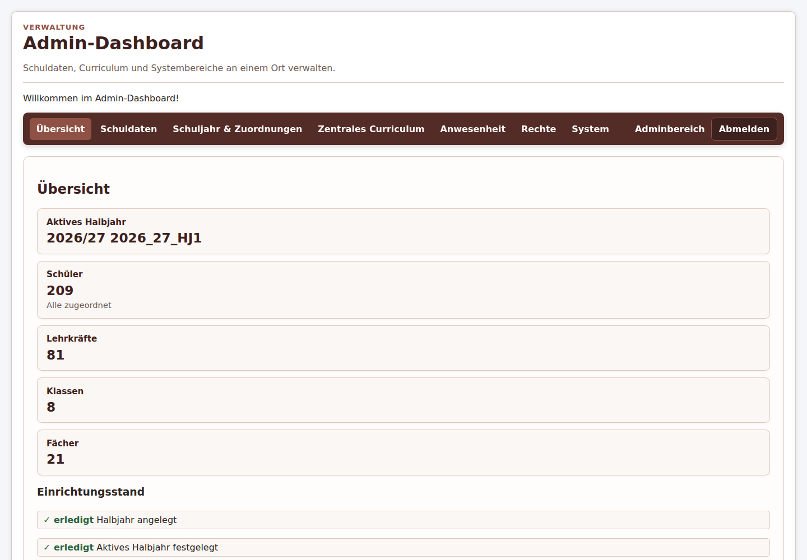
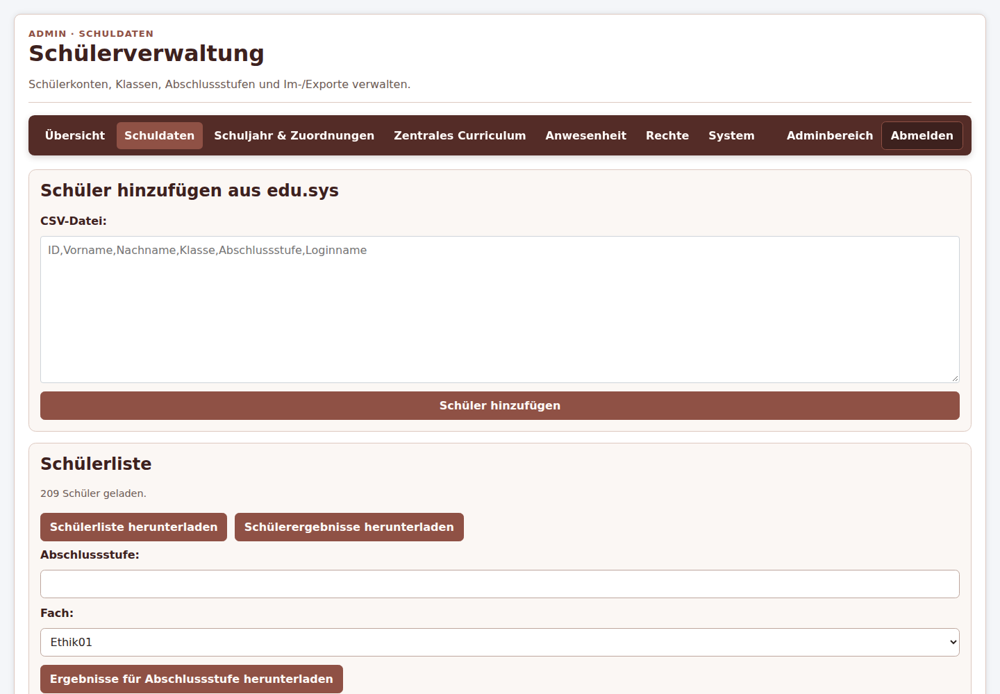
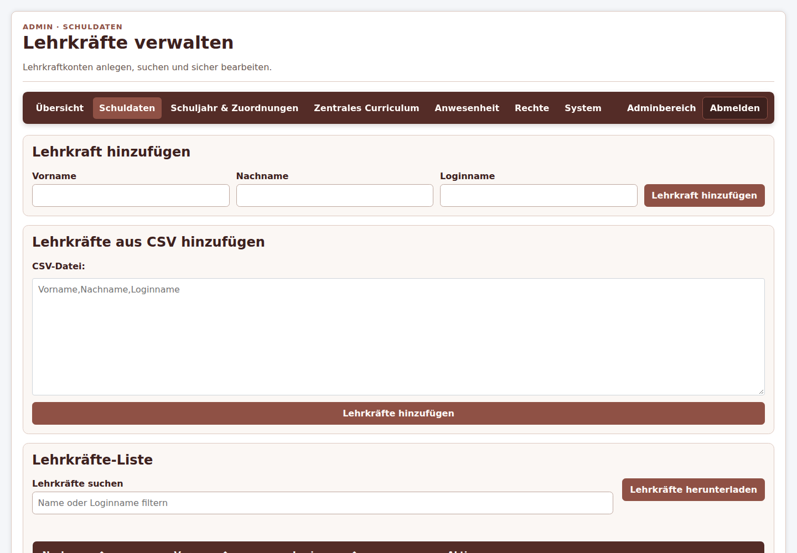
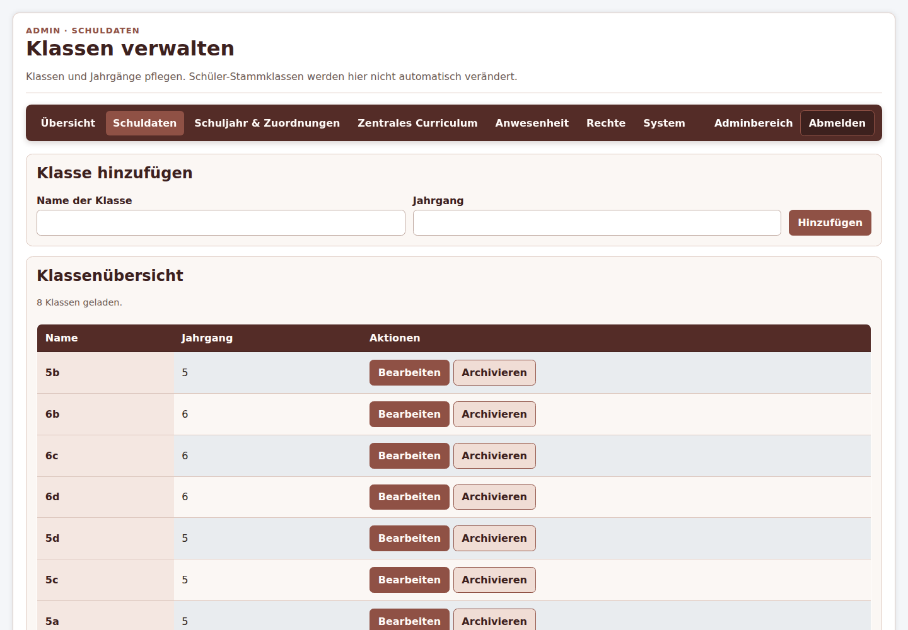
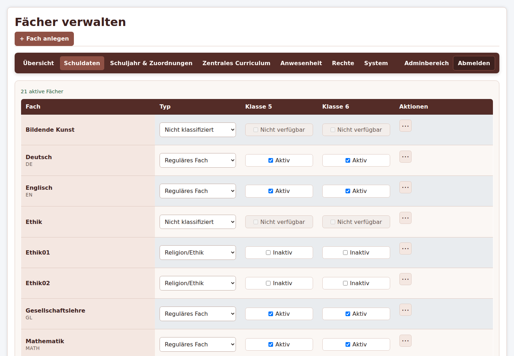
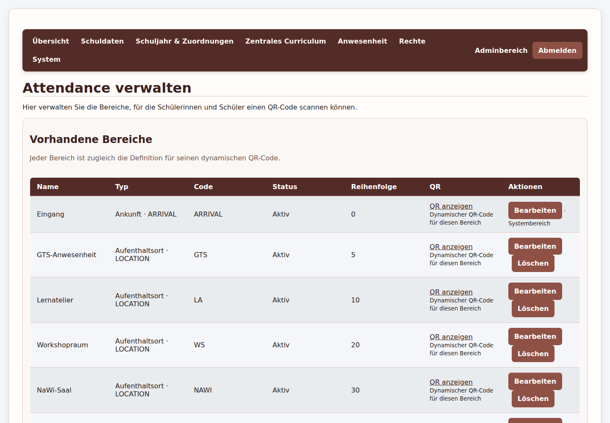
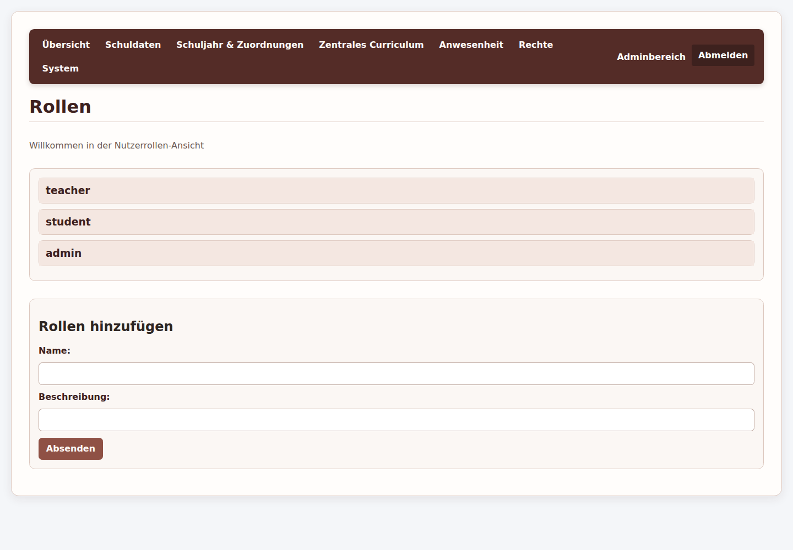
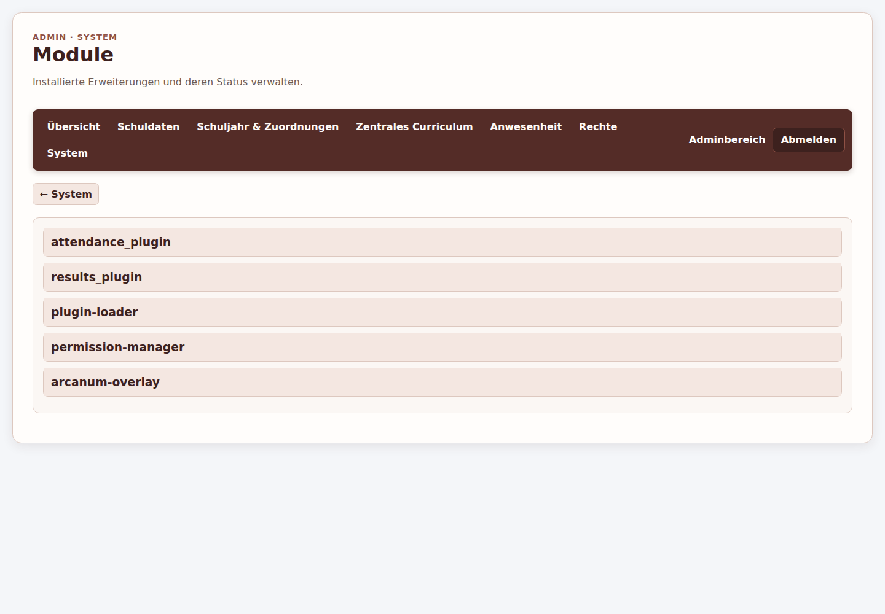

# Administrationsrundgang durch die Arcanum-DEMO

Verwende ausschließlich den öffentlichen Demo-Administrator **Ada Ananas**
(`ada.ananas`) aus der [verbindlichen Zugangsdaten-PDF](../Arcanum_DEMO_Zugangsdaten.pdf).
Das Passwort wird nicht wiederholt. Dieser Rundgang ist eine lesende
Funktionsabnahme vom 16.10.2026 bei 1440 px. Formulare und Vorschauen werden
gezeigt, aber keine Änderungen gespeichert.

## 1. Dashboard und Sicherheitsregeln

Die Hauptnavigation lautet **Übersicht**, **Schuldaten**, **Schuljahr &
Zuordnungen**, **Zentrales Curriculum**, **Anwesenheit**, **Rechte**,
**System**, **Adminbereich** und **Abmelden**. Das Live-Dashboard zeigte
aktives Halbjahr 2026/27 HJ1, 209 Schüler, 81 Lehrkräfte, 8 Klassen und 21
Fächer.

Halbjahr anlegen/aktivieren, Import bestätigen, Rollen oder Module speichern,
Konten anlegen, archivieren, löschen oder Passwörter zurücksetzen werden auf
der gemeinsam genutzten DEMO nicht ausgeführt.

## 2. Schuldaten

### Schülerverwaltung

`/manage_students` enthält **Schüler hinzufügen aus edu.sys**, CSV-Bezug,
Schüler hinzufügen, die Liste mit 209 Schülern, Schülerliste/-ergebnisse
herunterladen und Ergebnisse nach Abschlussstufe herunterladen. Filter sind
Fach, Status aktive/archivierte Schüler, Klasse und Suche. Die Tabelle zeigt
Nachname, Vorname, Klasse, Abschlussstufe sowie **Bearbeiten**,
**Archivieren** und **Passwort neu setzen**.

Exportdateien können Lerninformationen enthalten und werden nicht erzeugt.
Archivieren, Passwortsetzen und Bearbeiten benötigen Adminrechte und können
dauerhafte oder sicherheitsrelevante Folgen haben.

### Lehrkräfte

`/manage_teachers` bietet Vorname, Nachname und Loginname, Lehrkraft
hinzufügen, CSV-Eingabe, Suche, Lehrkräfte herunterladen, Bearbeiten und
Passwort neu setzen. Die Live-Liste enthielt 81 Lehrkräfte. Kein Import und
keine Kontobearbeitung wurde gespeichert.

### Klassen

`/manage_classes` zeigt Klassenname und Jahrgang sowie die Übersicht. Im
Livebild waren 8 Klassen vorhanden: 5a–5d und 6a–6d. Bearbeiten und
Archivieren können Stammzuordnungen beeinflussen. Systemklasse 0 wird nicht
gelöscht.

## 3. Fächer und Zuordnungen

`/manage_subjects` zeigte 21 aktive Fächer. Die Tabelle enthält Fachname,
Fachtyp (regulär, Religion/Ethik oder WPF), Aktivität für Klasse 5 und Klasse
6 sowie ein Aktionsmenü. Reguläre Kernfächer waren für beide Jahrgänge aktiv;
WPF-Fächer nur für Klasse 6. Einzelne Religion/Ethik-Fächer waren inaktiv oder
nicht verfügbar.

**Schuljahr & Zuordnungen** enthält aktives Halbjahr, Tutor:innen je Klasse,
Fachlehrkräfte je Jahrgang/Klasse und individuelle Fächer/WPF. Auswahl ohne
Speichern ist lesend; Autosave oder Speichern wurde nicht ausgelöst.

## 4. Schuljahr, Halbjahre und Kursgruppen

Die Ansicht zeigt 2026/27 HJ1 als **AKTIV**, **+ Nächstes Halbjahr anlegen**,
Tutor 1 und Tutor 2 je Klasse, Jahrgang 5/6, Fachlehrkraftmatrizen und
individuelle Zuordnungen. Daraus ergeben sich Unterrichtskontexte und
Kursgruppen/Mitgliedschaften.

Ein Halbjahreswechsel verändert den zeitlichen Geltungsbereich von Klassen,
Fächern, Kontexten, Curriculum und Lernständen. Er benötigt Adminrechte,
Vorprüfung und eine Sicherung und wird nicht ausgeführt.

## 5. Zentrales Curriculum und Import

**Zentrales Curriculum** zeigt Themen und Etappen mit Fach-/Jahrgangsbezug,
Münzwerten und **Neues Thema hinzufügen**. **Zentrales Curriculum
importieren** bietet **Vorschau prüfen** und **Import bestätigen**.

Die Vorschau prüft lesend, welche Inhalte neu, geändert oder bereits vorhanden
sind. Erst **Import bestätigen** schreibt in das aktive Halbjahr. Ein echter
Import wurde nicht ausgeführt; dafür gibt es keinen PASS.

## 6. Anwesenheit und QR-Bereiche

`/attendance-admin` verwaltet dynamische QR-Bereiche. Vorhanden waren
**Eingang (ARRIVAL)**, **GTS-Anwesenheit (GTS)**, **Lernatelier (LA)**,
**Workshopraum (WS)**, **NaWi-Saal (NAWI)**, **Input-Raum 1 (INPUT1)** und
**Gelingensnachweisraum (GN)**. Typ, Code, Status, Reihenfolge, QR-Anzeige,
Bearbeiten und Löschen werden angezeigt.

**QR anzeigen** ist lesend. **Neuen Bereich anlegen**, Bearbeiten und Löschen
wurden nicht gespeichert. `/attendance` bietet zusätzlich Datum, Zeitbezug,
Standort, Status, Klasse und Suche für die schulweite Übersicht.

## 7. Rechte und Module

`/manage_permissions` listet **teacher**, **student** und **admin** und bietet
Rollen hinzufügen mit Name und Beschreibung. Eine Rollenänderung kann Zugriff
auf Lern- und Verwaltungsdaten erweitern; es wurde nichts gespeichert.

`/plugins` listet **attendance_plugin**, **results_plugin**, **plugin-loader**,
**permission-manager** und **arcanum-overlay**. Status und Details sind
lesend. Installieren, Deaktivieren, Konfiguration speichern und Neustarts sind
nicht Teil der Prüfung.

## 8. Ergebnisse, Filter und kritische Aktionen

Lesefilter, Suche, Klassen-/Fachauswahl und Vorschauen wurden geprüft.
Import, Semesterwechsel, Löschen, Rollenänderung, Passwortänderung und echte
Exporte wurden nicht ausgeführt, weil ihre Wirkung ohne Mutation nicht
beweisbar und auf einer gemeinsam genutzten DEMO nicht sicher rückgängig zu
machen ist. Das sind **NICHT_SICHER_AUSFÜHRBAR**, keine PASS-Ergebnisse.

## 9. Checkliste

- [ ] Mit Ada Ananas aus der PDF angemeldet.
- [ ] Adminnavigation und Bestandskennzahlen gelesen.
- [ ] Schüler-, Lehrkräfte-, Klassen- und Fächerverwaltung geöffnet.
- [ ] Filter, Suche, Vorschauen und Auswahlfelder geprüft.
- [ ] Schuljahr, aktives Halbjahr, Tutor- und Fachzuordnungen betrachtet.
- [ ] Curriculum, Importvorschau und Münzbudgets eingeordnet.
- [ ] Anwesenheitsbereiche und QR-Anzeige gelesen.
- [ ] Rollen und Module betrachtet.
- [ ] Keine kritische Speicherung, kein Import, keine Löschung, kein
  Passwortwechsel und kein Semesterwechsel ausgeführt.
- [ ] Abgemeldet.
