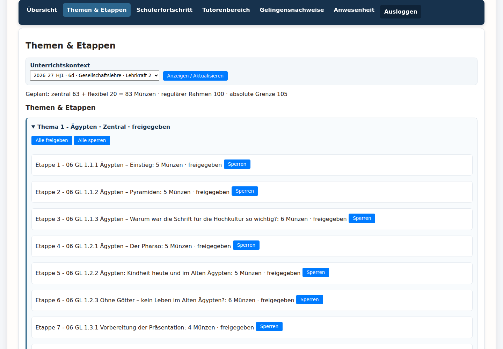
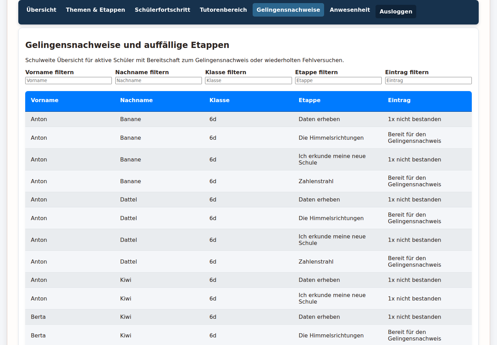
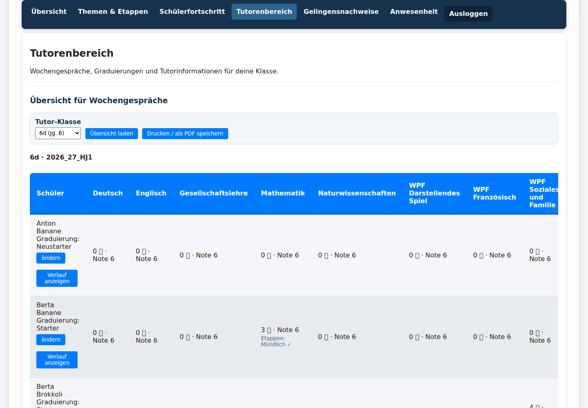
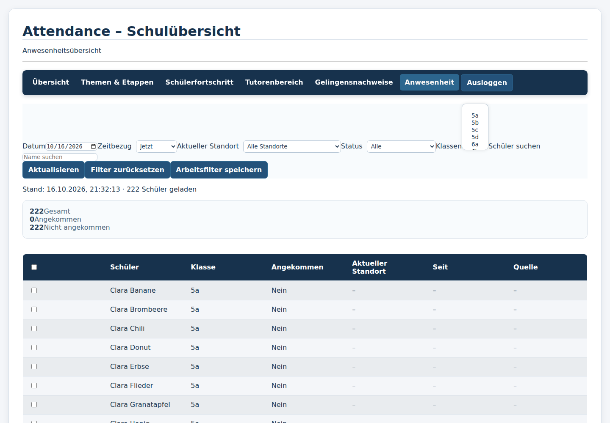

# Lehrkraftrundgang durch die Arcanum-DEMO

Verwende für den vollständigen Tutor-Rundgang **Dora Dinkel**
(`dora.dinkel`) aus der [öffentlichen Zugangsdaten-PDF](../Arcanum_DEMO_Zugangsdaten.pdf).
Das Passwort wird nicht wiederholt. Dora ist der empfohlene Tutorzugang für
Klasse 6d. Die Live-Aufnahmen wurden am 16.10.2026 mit 1440 px erstellt; die
Namen in den Tabellen sind synthetische DEMO-Namen.

## 1. Anmeldung und Navigation

Nach der Anmeldung öffnet sich das **Teacher Cockpit** (Lehrkraft-Übersicht).
Die Hauptnavigation enthält **Übersicht**, **Themen & Etappen**,
**Schülerfortschritt**, **Tutorenbereich**, **Gelingensnachweise**,
**Anwesenheit** und **Ausloggen**.

Dora hatte im Live-Lauf das aktive Halbjahr `2026_27_HJ1`, eine Lerngruppe,
zwei Fächer und zwei Unterrichtskontexte: 6d Gesellschaftslehre und 6d
Mathematik.

## 2. Unterrichtskontext

Ein **Unterrichtskontext** verbindet Halbjahr, Klasse, Fach und zuständige
Lehrkraft. Wähle in den folgenden Bereichen zunächst den passenden Kontext.
Eine fehlende Klasse ist meist eine Zuordnungs- oder Berechtigungsgrenze,
nicht automatisch eine leere Schülerdatenbank.

## 3. Themen & Etappen

Öffne **Themen & Etappen**, wähle den Kontext und klicke **Anzeigen /
Aktualisieren**. Die getestete Ansicht zeigte: zentral 63 + flexibel 20 = 83
geplante Münzen, regulärer Rahmen 100 und absolute Grenze 105. Sichtbar waren
zentrale Themen wie „Ägypten“ und „Kinderwelten“ sowie flexible Themen „Erste
Schulwoche“ und „Mitarbeit“.

Jede Etappe zeigt Nummer, Niveau, Titel, Münzwert und Status. **Zentral** ist
gemeinsamer Curriculum-Inhalt, **Flexibel** gehört zum Kontext.
„Freigegeben“ und „gesperrt“ sind Zugangsstatus, keine Leistungsnote.
Variable Münzvergabe betrifft den später tatsächlich verliehenen Wert innerhalb
des Budgets.

**Freigeben**, **Alle freigeben**, **Sperren**, **Alle sperren**, **Speichern**,
**Anlegen**, **Umbenennen** und **Löschen** können Schülerzugang, Curriculum
oder Münzplanung verändern. Sie wurden nicht angeklickt. Kontextauswahl und
Auf-/Zuklappen sind lesend.

## 4. Schülerfortschritt

Öffne **Schülerfortschritt**, wähle den Kontext und klicke **Aktualisieren**.
Die Tabelle enthielt mehrere zugeordnete synthetische Schüler, darunter Anton
Banane, Berta Banane und Anton Dattel. Spalten:

- **Details** öffnet den individuellen Schülerfall;
- **In Bearbeitung** zeigt die aktuelle Etappe oder „Keine Etappe in
  Bearbeitung“;
- **Braucht Hilfe**, **Sucht Partner**, **Will experimentieren** und **Bereit
  für Gelingensnachweis** zeigen die Schüler-Signale.

Ein Gedankenstrich bedeutet kein Signal in diesem Kontext. Die Tabelle ist
Gesprächs- und Planungshilfe, keine Rangliste. Details sind lesend; Bewertungs-
und Bestätigungswege werden nicht ausgeführt.

## 5. Gelingensnachweise und Fehlversuche

Öffne **Gelingensnachweise**. Die Seite heißt vollständig
**Gelingensnachweise und auffällige Etappen**. Sie enthielt gefüllte Einträge,
darunter Klasse 6d, Etappen, „Bereit für den Gelingensnachweis“ und
„1x nicht bestanden“.

Die fünf Lesefilter **Vorname**, **Nachname**, **Klasse**, **Etappe** und
**Eintrag** schränken nur die Liste ein. Bereitschaft ist kein Bestanden; ein
einmaliger Fehlversuch ist kein dauerhafter Sperrzustand. Bestätigung oder
Statusänderung werden nicht ausgeführt.

## 6. Tutorenbereich und Wochenübersicht

Öffne **Tutorenbereich**, wähle **6d (Jg. 6)** und klicke **Übersicht laden**.
Der Live-Lauf zeigte 25 Schüler. Die Tabelle enthält Namen, Graduierung,
Fachmünzen und daraus abgeleitete Noten für Deutsch, Englisch,
Gesellschaftslehre, Mathematik, Naturwissenschaften und verfügbare WPF-
Spalten.

**Verlauf anzeigen** öffnet die zeitliche Lernansicht. **ändern** bearbeitet
die Graduierung und wird nicht verwendet. **Drucken / als PDF speichern** ist
eine Ausgabe, kann aber Schülerdaten enthalten und darf nur sicher gespeichert
oder geteilt werden.

Eine Fachlehrkraft sieht ihren Fachkontext und die zugeordneten Schüler. Die
Tutor-Lehrkraft bündelt zusätzlich die eigene Klasse über mehrere Fächer und
für Wochengespräche.

## 7. Anwesenheit

Öffne **Anwesenheit**. Verfügbar sind Datum, Zeitbezug, aktueller Standort,
Status, Klassenfilter und Schülersuche. Standorte im Livebild waren Eingang
(ARRIVAL), GTS, Lernatelier (LA), Workshopraum (WS), NaWi-Saal (NAWI),
Input-Raum 1 (INPUT1) und Gelingensnachweisraum (GN).

**Aktualisieren** lädt die Lesesicht, **Filter zurücksetzen** stellt die
neutrale Sicht her. **Arbeitsfilter speichern** und Anwesenheitsbestätigungen
können schreiben und werden nicht ausgeführt. Der Lauf zeigte 222 Schüler,
0 angekommen und 222 nicht angekommen; die Zahlen sind Momentwerte.

## 8. Noten, Graduierung, Druck und Rechte

Fachmünzen, bestätigte Etappen, Zwischenstand und gegebenenfalls Prognose
gehören zum Fachkontext. Die Graduierung ist davon getrennt. Eine
Fachlehrkraft darf nicht automatisch globale Adminbereiche sehen; die Sicht
folgt Zuordnung und Rolle.

## 9. Gefahrlos ausprobieren

Sicher sind Navigation, Kontextauswahl, Aktualisieren, Auf-/Zuklappen,
Lesefilter, Suche, Details und Verlauf. Nicht ausführen: Freigeben, Sperren,
Bestätigen, Speichern, Anlegen, Umbenennen, Ändern, Löschen,
Anwesenheit bestätigen und echte Exporte mit Schülerdaten.

## 10. Checkliste

- [ ] Mit Dora Dinkel aus der PDF angemeldet.
- [ ] Aktives Halbjahr, Lerngruppen, Fächer und Kontexte gelesen.
- [ ] Zentral/flexibel, Münzbudget, Freigabe und variable Münzvergabe erklärt.
- [ ] Gefüllten Schülerfortschritt im passenden Kontext geöffnet.
- [ ] Schülerdetails und Signale eingeordnet.
- [ ] Gefüllte GN-Liste mit Bereitschaften und Fehlversuchen gesehen.
- [ ] Tutor-Klasse 6d geladen und 25 Schüler geprüft.
- [ ] Fachlehrkraft und Tutorrolle unterschieden.
- [ ] Anwesenheit gefiltert, aber nichts bestätigt oder gespeichert.
- [ ] Ausgeloggt.
