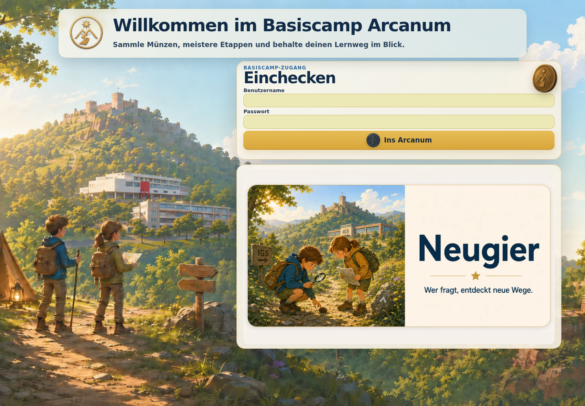
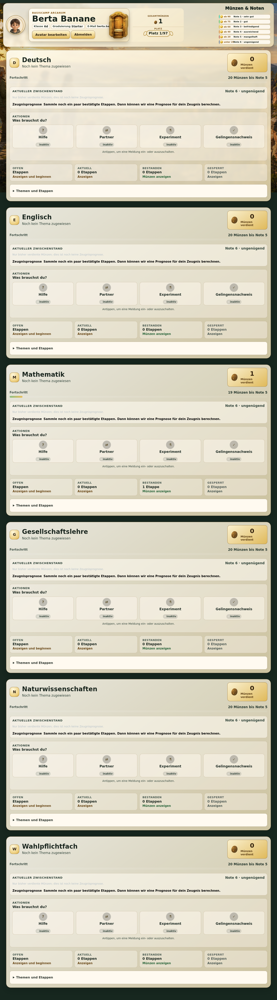
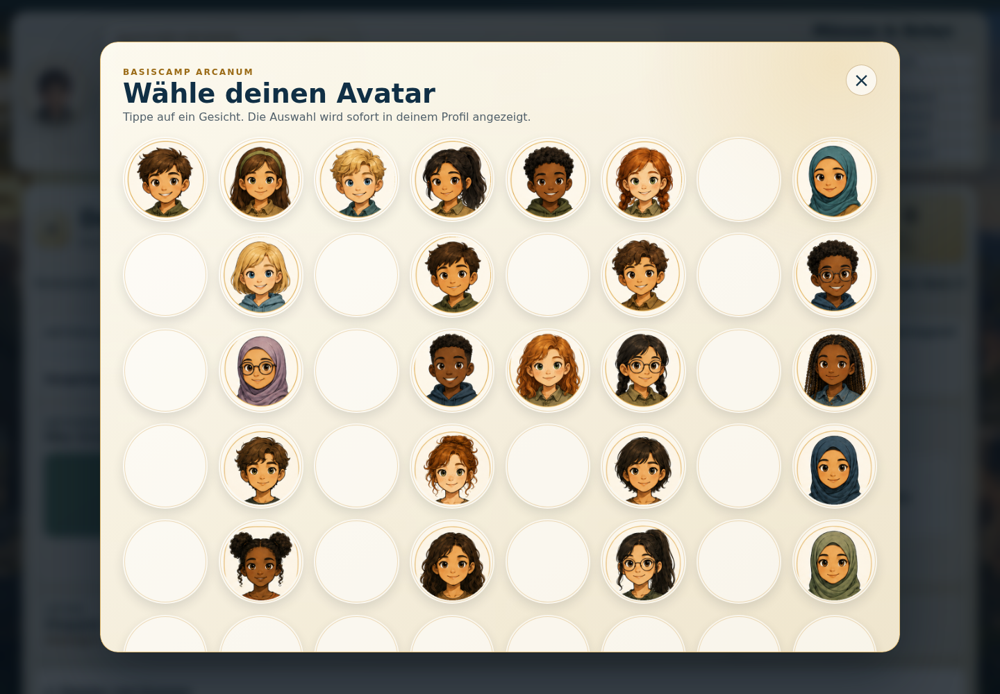
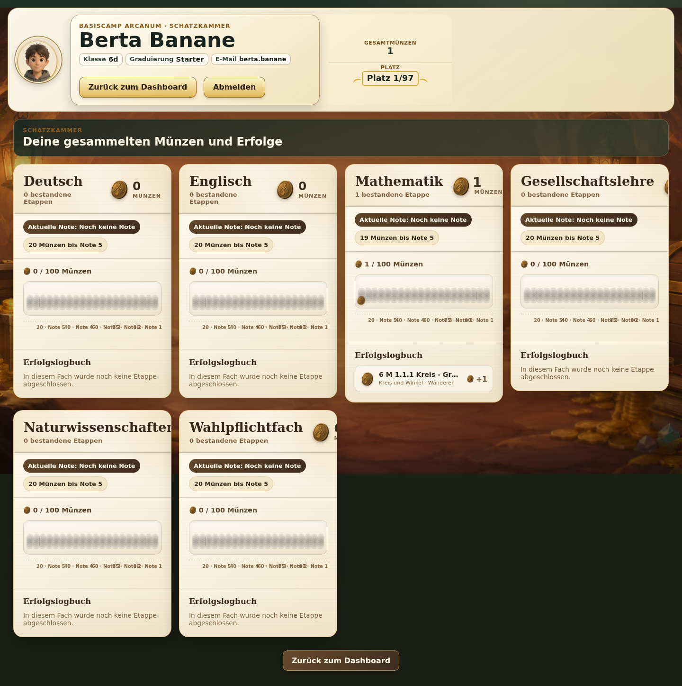

# Schülerrundgang durch die Arcanum-DEMO

Dieser Rundgang zeigt die Schüleransicht der laufenden DEMO mit dem
synthetischen Konto **Anton Apfel** (`anton.apfel`, Klasse 6a). Das Passwort
wird ausschließlich aus der [verbindlichen öffentlichen
Zugangsdaten-PDF](../Arcanum_DEMO_Zugangsdaten.pdf) übernommen und hier nicht
wiederholt. Die Aufnahmen und Befunde stammen vom 17.10.2026, Breite 1440 px.

## 1. Anmeldung und sicher beginnen

1. Öffne die [DEMO-Anmeldung](https://arcanum-demo.dynv6.net/login).
2. Trage den Benutzernamen und das Passwort aus der PDF ein.
3. Klicke **Ins Arcanum**. Danach erscheint das Schülerdashboard.
4. Prüfe oben Name, Klasse und Benutzernamen: Anton Apfel, 6a und
   `anton.apfel`.

Die DEMO ist gemeinsam genutzt. Lies und filtere möglichst nur. Meldungen,
Avatarwahl und das Beginnen einer Etappe können den gemeinsamen Zustand ändern.

## 2. Dashboard lesen

Oben stehen **Klasse**, **Graduierung**, **E-Mail/Benutzername**, Avatar,
**Gesamtmünzen** und **Platz**. Im Livezustand waren die Werte `6a`,
`Starter`, `anton.apfel`, `1 Münze`; der Rang lautete „Du bist nicht in den
Top Ten.“ Das ist ein Vergleich innerhalb des Jahrgangs und keine Schulnote.

Die Graduierung beschreibt Selbstständigkeit und Verantwortung. Sie ist nicht
das akademische Etappen-Niveau **Wanderer**, **Bergsteiger** oder
**Gipfelstürmer**.

Rechts zeigt die Legende die Notengrenzen:

| Verdiente Münzen | aktueller Zwischenstand |
|---:|---|
| ab 90 | Note 1 · sehr gut |
| ab 75 | Note 2 · gut |
| ab 60 | Note 3 · befriedigend |
| ab 40 | Note 4 · ausreichend |
| ab 20 | Note 5 · mangelhaft |
| unter 20 | Note 6 · ungenügend |

**Verdiente Münzen** sind bestätigte Leistungen. Eine geplante oder maximal
mögliche Münzzahl ist noch kein Verdienst. Bei einer variablen flexiblen
Etappe kann später zum Beispiel „2 von 4“ erscheinen: 4 war das Maximum, 2
wurden tatsächlich gutgeschrieben.

## 3. Fachkarten und Noten

Unter **Münzen & Noten** erscheinen im aktuellen Konto Deutsch, Englisch,
Mathematik, Gesellschaftslehre, Naturwissenschaften und ein individuelles
Wahlpflichtfach. Eine Fachkarte enthält Fachname, verdiente Münzen,
Fortschritt, Abstand zur nächsten Notengrenze, **aktuellen Zwischenstand**,
**Zeugnisprognose**, Aktionen und die vier Etappenstatus.

Im Livebild standen in Antons gezeigter Karte 1 Münze, „19 Münzen bis Note 5“
und „Note 6 · ungenügend“. Die Anzeige sagt ausdrücklich, dass dies nur der
bisherige Zwischenstand und noch keine Zeugnisprognose ist. Eine Prognose ist
eine mögliche Entwicklung, keine eingetragene Zeugnisnote. Bei zu wenigen
bestätigten Etappen erscheint ein Hinweis statt einer Zahl.

„Noch kein Thema zugewiesen“ ist ein echter Kontozustand und darf nicht durch
eine erfundene Etappe ersetzt werden.

### Gefülltes Vergleichsbeispiel: Berta Banane

Für die folgenden Beispiele mit verdienten Leistungen melde dich mit
**Berta Banane** (`berta.banane`) aus derselben PDF an. Dieses Konto ist ein
anderer, ausdrücklich veröffentlichter Schülerzugang. Es zeigt im geprüften
Livezustand 1 Gesamtmünze, Klasse 6d und die Graduierung Starter. Zusätzlich
ist ein erster Fehlversuch einer zweiten Mathe-Etappe im Lehrkraftbereich sichtbar.

Die Karte zeigt Mathematik mit 1 Münze und einer bestandenen Etappe. Damit ist der
Unterschied zwischen einem leeren Lernstand (Anton) und tatsächlich
verdienten Leistungen (Berta) sichtbar belegt.

## 4. Avatar

Klicke **Avatar bearbeiten**. Es öffnet sich ein Auswahlfenster mit den
verfügbaren Gesichtern.

Das Öffnen ist lesend. Eine Auswahl kann sofort wirksam werden; im Abnahmelauf
wurde kein neues Gesicht gespeichert. Der Avatar ändert weder Münzen noch
Noten, Rang, Etappen oder Prognosen.

## 5. Aktionen: Hilfe, Partner, Experiment, Gelingensnachweis

Jede Fachkarte enthält vier Meldungen. Der Zustand steht als **aktiv** oder
**inaktiv** sichtbar:

- **Hilfe** bittet die zuständige Lehrkraft um Unterstützung.
- **Partner** schaltet die Partnersuche ein oder aus; ohne Treffer wird kein
  Partner erfunden.
- **Experiment** meldet Betreuungsbedarf.
- **Gelingensnachweis** meldet Bereitschaft. Das ist kein automatisches
  Bestanden und keine automatische Münzgutschrift.

Im geprüften Konto war Hilfe aktiv, Partner, Experiment und
Gelingensnachweis waren inaktiv. Ein Klick wäre reversibel, wurde wegen der
gemeinsamen Datenbank aber nicht ausgeführt.

## 6. Etappenstatus und Themen

Die vier Kacheln **Offen**, **Aktuell**, **Bestanden** und **Gesperrt** sind
unabhängig von den Meldungen:

- **Offen**: freigegebene Etappen, die begonnen werden können;
- **Aktuell**: begonnene, noch nicht bestätigte Etappen;
- **Bestanden**: bestätigte Leistungen;
- **Gesperrt**: derzeit nicht bearbeitbare Etappen.

Anton Apfels Livezustand zeigte eine bestandene und eine aktuell begonnene
Mathe-Etappe; offene und gesperrte Etappen blieben in der geprüften Karte bei
0. Das ist ein konkreter Musterverlauf, kein allgemeiner Zustand aller Konten.

Berta zeigt in Mathematik **1 bestandene Etappe** und einen ersten Fehlversuch
bei einer weiteren Etappe. Eine gefüllte Kachel ist
damit ein echter Nachweis für den jeweils sichtbaren Zustand, aber kein Beleg,
dass jedes Konto dieselben Etappen besitzt.

In Bertas Mathematik-Karte steht der aktuelle Zwischenstand „Note 6 ·
ungenügend“ und „19 Münzen bis Note 5“. Das ist eine aus bisher verdienten
Münzen berechnete Momentaufnahme. Eine Zeugnisprognose wird dort ausdrücklich
noch nicht berechnet. Die Anzeige „Sammle noch ein paar bestätigte Etappen …“
ist deshalb nicht als Prognose zu lesen.

**Anzeigen und beginnen** öffnet die offene Liste. Das Beginnen wurde nicht
ausgeführt. Themen und Etappen zeigen den Lernplan: zentrale Etappen kommen
aus dem gemeinsamen Curriculum, flexible aus dem Unterrichtskontext. Erst eine
bestätigte Leistung verdient Münzen.

## 7. Reguläre Fächer und WPF

Reguläre Fächer gehören zum Lernplan der Klasse. Das individuelle WPF
(Wahlpflichtfach) ist dem einzelnen Schüler zugeordnet. Es ist nicht
automatisch leichter oder schwerer; Etappen, Münzen, Noten und Prognosen
folgen derselben Logik. Andere Schüler können ein anderes WPF oder keines haben.

Bei Berta war im geprüften Lauf kein neuer WPF-Abschluss Teil des Neuaufbaus;
die individuelle WPF-Zuordnung bleibt als Fachangebot sichtbar.

## 8. Schatzkammer und Verlauf

Der Link oben führt zu **Schatzkammer / Ergebnisse** (`/results`). Dort sollen
Gesamtmünzen, Klasse, Graduierung, Rang, Fachsummen, bestandene Etappen und
das Erfolgslogbuch erscheinen. Das Logbuch ordnet Münzen bestätigten Etappen
zu; variable Leistungen können ihren tatsächlichen Wert gegenüber dem Maximum
zeigen.

Mit Anton Apfel, Berta Banane und Dora Kakao lädt `/results` nach dem
Neuaufbau jeweils mit HTTP 200. Anton zeigt 1 Mathe-Münze, Berta 1 Mathe-Münze
und Dora Kakao 3 Deutsch-Münzen aus einer bestätigten Etappe.

Eine berechnete Zeugnisprognose war bei den drei neu geprüften Konten wegen
der noch kleinen Zahl bestätigter Etappen nicht verfügbar. Eine variable
Etappe wurde als Lehrkraftbeispiel angelegt und freigegeben, aber im Lauf noch
nicht regulär abgeschlossen; deshalb wird keine variable Gutschrift behauptet.

## 9. Abmelden, Fehler und Grenzen

**Abmelden** beendet die Sitzung. Bei einem leeren Lernstand werden keine
Testdaten angelegt. Auf 1440 px war kein horizontaler Überlauf sichtbar; die
Projektprüfung weist 768 px als unterstützt aus. Bei 390 px ist seitliches
Scrollen als bekannte Einschränkung dokumentiert. Laptop oder Tablet sind
deshalb geeigneter.

## 10. Checkliste

- [ ] Mit Anton Apfel aus der PDF angemeldet.
- [ ] Klasse, Graduierung, Rang und Gesamtmünzen gefunden.
- [ ] Notengrenzen, Zwischenstand und Prognose unterschieden.
- [ ] Reguläre Fächer und individuelles WPF gefunden.
- [ ] Vier Meldungen und vier Etappenstatus unterschieden.
- [ ] Geplante/maximale von verdienten Münzen getrennt.
- [ ] Avatar-Dialog geöffnet, aber nichts gespeichert.
- [ ] Schatzkammer-Ladebefund beachtet und keine Ansicht erfunden.
- [ ] Abgemeldet.
